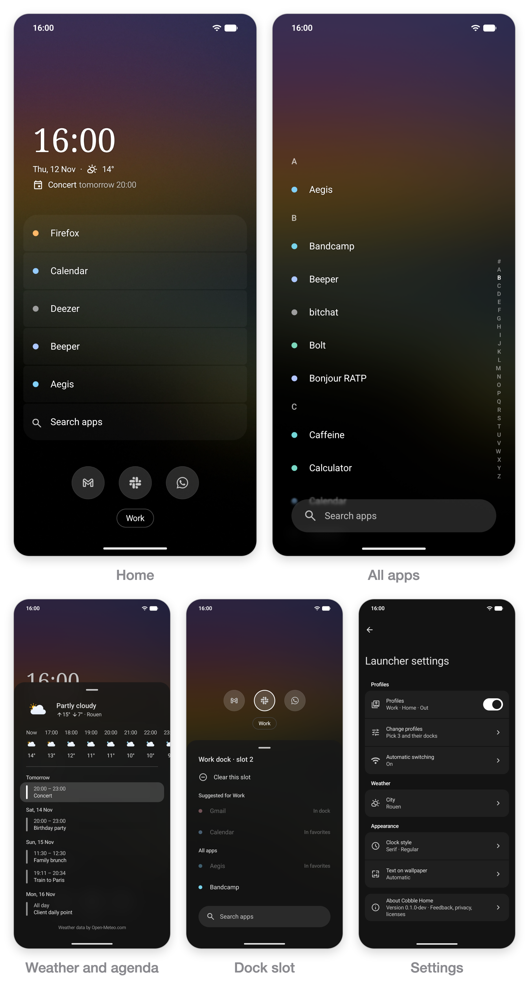
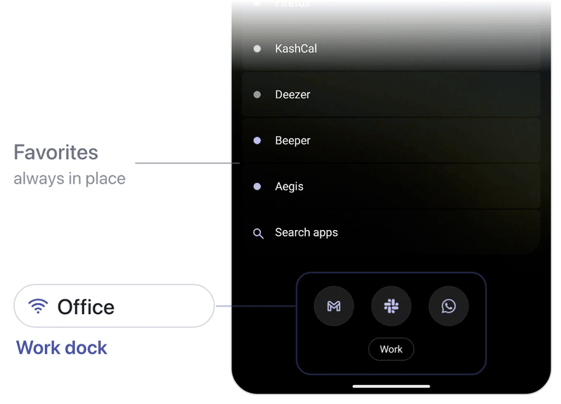
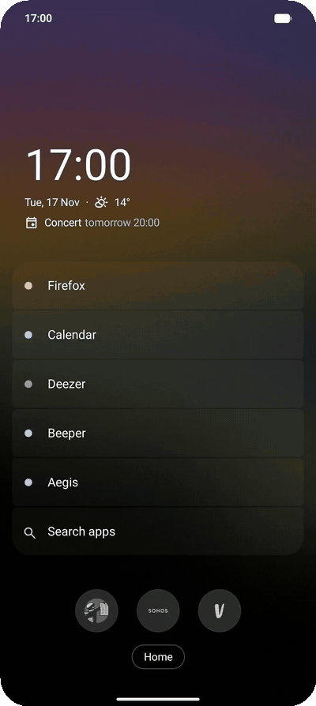
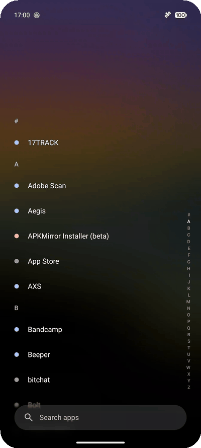

<p align="center">
  
</p>

<h1 align="center">Cobble Home</h1>

<p align="center"><b>A decluttered, context-aware home screen that respects your time and privacy.</b></p>

<p align="center">An Android launcher with a fixed list of favorites and a three-app dock that follows your context.<br>
No tracking, free and open source.</p>

> **Download:** [Cobble Home 1.0.0 (beta)](https://github.com/tomlmbl/cobble-home/releases/tag/v1.0.0) — APK for Android 15+.

<p align="center">
  
</p>

## Features

- **Home screen:** clock, weather, next calendar event, up to six favorite apps in the order you set, and a search line.
  Nothing on it is reordered automatically.
- **All apps:** text search, or an alphabet slider usable with one thumb.
- **Profiles:** none, or three picked from a list (for example Work, Home, Out). Each profile has a dock of three apps
  you choose. Only the dock changes with the profile.
- **Profile switching:** manual, or automatic from saved Wi-Fi networks (below). Automatic switching can be turned off.
- **Not included:** widgets, icon packs, configurable gestures, usage-based suggestions.

All apps remain reachable without network and without any optional permission.

## How profiles work

<p align="center">
<picture>
  <source media="(prefers-color-scheme: dark)" srcset=".github/assets/profiles-dark.gif">
  
</picture>
</p>

Your favorites never move. Only the three dock apps change with the profile.

- **By hand:** tap the profile name under the dock, at any time.
- **Joining a saved Wi-Fi network:** switches to its profile after 5 seconds connected.
- **Leaving it:** switches to Out after 5 seconds without a saved network, if Out is one of your profiles.
- **Turning Wi-Fi off:** changes nothing.
- **Never** by time of day, and never while you are using the screen: the change waits until the home screen is idle.

A manual choice holds until the next saved network. Automatic switching can be turned off.

## Within thumb reach

<p align="center">
<picture>
  <source media="(prefers-color-scheme: dark)" srcset=".github/assets/search-dark.gif">
  
</picture>
&nbsp;
<picture>
  <source media="(prefers-color-scheme: dark)" srcset=".github/assets/rail-dark.gif">
  
</picture>
</p>

- **Six favorites at most,** so they stay within reach of your thumb.
- **Search** sits at the bottom of the list; results stack from the bottom, the best match next to the search field.
- **The alphabet slider** runs along the edge of the app list: slide your thumb to jump to a letter.

## Privacy

No account, analytics, advertising ID, crash reporting or telemetry. Data stays in the app's private storage.

**Asked only when you use the feature**

- **Location (precise):** Android only gives the name of the connected Wi-Fi to apps with this permission. Used to
  recognize saved networks; names never leave the phone. Asked when you turn on automatic switching.
- **Location (approximate):** *Use my location* for the weather picks the nearest city from a built-in list. Your
  position is not stored or sent. Asked when you tap it.
- **Calendar (read only):** shows your upcoming events. They are read when shown, never written, stored or logged.
  Asked when you tap the calendar button in the panel.

**Granted at install**

- **Internet:** weather from [Open-Meteo](https://open-meteo.com/), off until you pick a city.
- **Network and Wi-Fi state, expand status bar, request uninstall:** Wi-Fi connection changes, notification shade,
  *Uninstall* in an app's menu.

Refusing a permission only disables the feature that needs it. Details and data sent to Open-Meteo:
[PRIVACY.md](PRIVACY.md).

## Requirements

Android 15 or later. Google Play services are not needed.

## License

Free software under the [GNU General Public License v3.0 or later](LICENSE).

<details>
<summary><b>For developers</b>: build from source, reproducible builds, contributing</summary>

### Build from source

Requires JDK 21 and the Android SDK.

```sh
./gradlew :app:assembleDebug
```

Release builds are reproducible: verification steps are in [REPRODUCIBLE_BUILDS.md](REPRODUCIBLE_BUILDS.md).

### Contributing

Bug reports and suggestions are welcome as [issues](https://github.com/tomlmbl/cobble-home/issues).
Please open an issue before starting work on a pull request.

### License details

`SPDX-License-Identifier: GPL-3.0-or-later`. Copyright (C) 2026 Tom Le Masson Banning Lover.

Third-party components and their licenses are listed in the app: *Settings › About › Open source licenses*.

</details>
