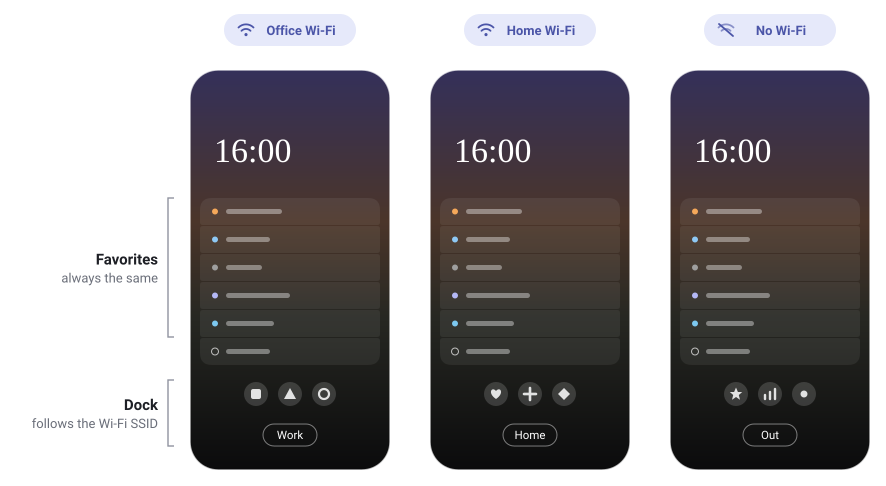

<p align="center">
  
</p>

<h1 align="center">Cobble Home</h1>

<p align="center"><b>A decluttered, context-aware home screen that respects your time and privacy.</b></p>

<p align="center">Android launcher. Favorites keep their place; only a three-app dock changes with your profile.<br>
No tracking, no ads, free and open source.</p>

> **Status:** not released yet. The first public beta will be an APK on GitHub, then on F-Droid.

<p align="center">
  
</p>

## Features

- **Home screen:** clock, weather, next calendar event, up to six favorite apps in the order you set, and a search line.
  Nothing on it is reordered automatically.
- **All apps:** text search, or an alphabet slider usable with one thumb.
- **Profiles:** none, or three picked from a list (for example Work, Home, Out). Each profile has a dock of three apps
  you choose. Only the dock changes with the profile.
- **Profile switching:** manual, or automatic from saved Wi-Fi networks (below). Automatic switching can be turned off.
- **Not included:** widgets, icon packs, configurable gestures, usage-based suggestions.

All apps remain reachable without network and without any optional permission.

## How profiles work

<picture>
  <source media="(prefers-color-scheme: dark)" srcset=".github/assets/switching-dark.svg">
  
</picture>

Profiles change by hand, or automatically when you join or leave a saved Wi-Fi network, never while you are using the
screen. Automatic switching can be turned off.

## Privacy

No account, analytics, advertising ID, crash reporting or telemetry. Data stays in the app's private storage.

- **Location (precise):** Android only gives the name of the connected Wi-Fi to apps with this permission. Used to
  recognize saved networks; names never leave the phone. Asked when you turn on automatic switching.
- **Location (approximate):** *Use my location* for the weather picks the nearest city from a built-in list. Your
  position is not stored or sent. Asked when you tap *Use my location*.
- **Calendar:** shows your next event. Events are not stored. Asked when you tap the calendar button in the panel.
- **Internet:** weather from [Open-Meteo](https://open-meteo.com/), off until you pick a city. Granted at install.
- **Network and Wi-Fi state, expand status bar, request uninstall:** Wi-Fi connection changes, notification shade,
  *Uninstall* in an app's menu. Granted at install.

Refusing a permission only disables the feature that needs it. Details and data sent to Open-Meteo:
[PRIVACY.md](PRIVACY.md).

## Requirements

Android 15 or later. Google Play services are not needed.

## Build from source

Requires JDK 21 and the Android SDK.

```sh
./gradlew :app:assembleDebug
```

Release builds are reproducible: verification steps are in [REPRODUCIBLE_BUILDS.md](REPRODUCIBLE_BUILDS.md).

## License

Cobble Home is free software under the [GNU General Public License v3.0 or later](LICENSE)
(`SPDX-License-Identifier: GPL-3.0-or-later`). Copyright (C) 2026 Tom Le Masson Banning Lover.

Third-party components and their licenses are listed in the app: *Settings › About › Open source licenses*.
